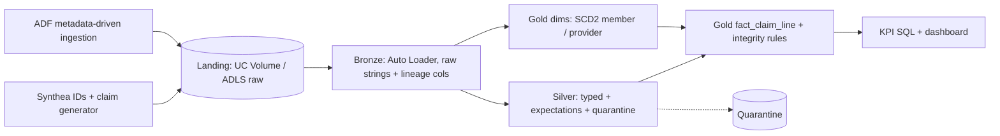
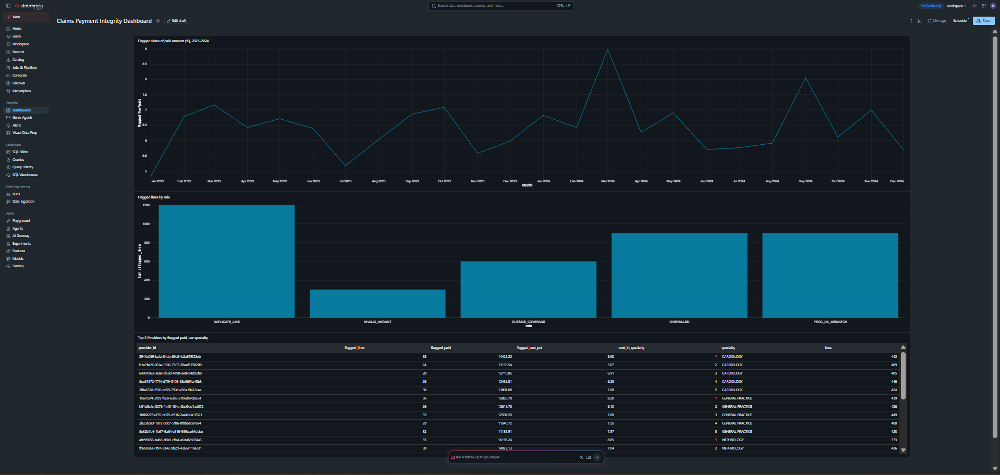
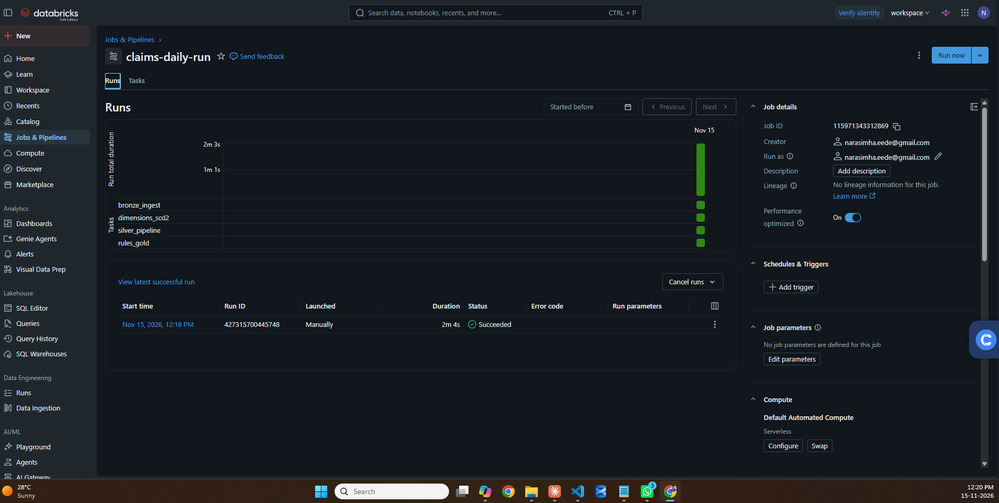
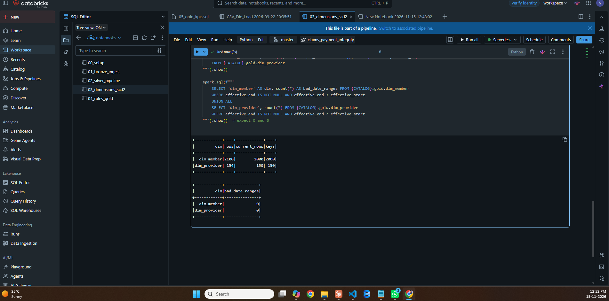

# Claims Payment Integrity Lakehouse

A healthcare claims data platform on Azure/Databricks that ingests claim, member, provider and
eligibility data, lands it in a Bronze/Silver/Gold lakehouse, and flags improper payments
(duplicates, overbilling, diagnosis/procedure mismatches, billing outside coverage, invalid
amounts) before they reach analysts.

> **Synthetic data only.** Members and providers come from [Synthea](https://github.com/synthetichealth/synthea)
> (or are randomly generated). Claim lines are generated with *labelled* injected anomalies so the rules can be
> scored. Procedure codes are invented demo codes and the procedure-to-diagnosis pairings carry no clinical meaning.
> No real patient data, and no claim of HIPAA compliance.

## What is verified and what is not

| Component | Status |
|---|---|
| Rule library (`src/claims_integrity/rules.py`) | Unit-tested with PySpark locally (`pytest`, 9 tests) |
| Data generator (`scripts/generate_claim_lines.py`) | Unit-tested; deterministic with a seed |
| Local end-to-end demo (`scripts/run_local_demo.py`) | Run locally; scores rules against injected ground truth |
| Databricks notebooks 00–04, Auto Loader bronze, silver declarative pipeline | **Run on Databricks Free Edition** (serverless); bronze, silver, SCD2 and gold row counts checked |
| SCD2 member/provider dimensions | **Run and verified**, including a second load and a repeat run (idempotent after a fix, see Lessons learned) |
| Workflow `claims-daily-run` (bronze, silver + SCD2 in parallel, rules/gold) | **Run end to end**, succeeded in 2m 4s |
| KPI queries + dashboard | **Run**; dashboard built from queries on the gold tables |
| CI (ruff + pytest on GitHub Actions) | Passing |
| Asset Bundle `databricks.yml` | Written, **not validated or deployed** |
| ADF framework + Azure SQL control scripts | Design + T-SQL, **not yet run in Azure** |
| Unity Catalog masks/grants (`sql/06_governance.sql`) | Pattern only, **not yet run**; Free Edition may not support all of it |

## Architecture



Details: [docs/architecture.md](docs/architecture.md), [docs/data_model.md](docs/data_model.md),
[docs/rules_catalog.md](docs/rules_catalog.md).

## Quick start (local, no cloud)

Requires Python 3.11+, Java 17+.

```bash
pip install -r requirements-dev.txt
pytest -q                                              # unit tests
python scripts/generate_claim_lines.py --out data/generated
python scripts/run_local_demo.py --data data/generated # rule hits + precision/recall
```

Optional: generate members/providers with Synthea first and pass `--patients patients.csv --providers providers.csv`.

## Run on Databricks Free Edition + Azure

Step by step in [docs/setup_free_tier.md](docs/setup_free_tier.md) and [docs/runbook.md](docs/runbook.md).

## Results (measured on Databricks Free Edition, synthetic data)

| Metric | Value |
|---|---|
| Claim lines processed (two loads) | 61,201 (bronze = silver = gold fact) |
| Silver quarantine | 0 rows |
| Flagged lines | 3,900 (about 6.4% of lines); no line tripped more than one rule |
| Flagged paid amount | 1,334,234.95 |
| Dimensions after load 2 | `dim_member` 2,100 rows / 2,000 current; `dim_provider` 154 rows / 150 current (one current row per key) |
| Full workflow run (serverless) | 2 min 4 s |
| Rule precision / recall on injected anomalies | Not measured on Databricks. Expect about 1.0 on this data because the generator and rules share definitions; this is a sanity check, not real-world accuracy |
| Query tuning (before/after) | Not measured. The data is too small for meaningful timings |

### Flagged lines by rule

| Rule | Flagged lines | Flagged paid |
|---|---|---|
| DUPLICATE_LINE | 1,200 | 362,408.23 |
| OVERBILLED | 900 | 265,161.73 |
| PROC_DX_MISMATCH | 900 | 259,994.42 |
| OUTSIDE_COVERAGE | 600 | 179,033.05 |
| INVALID_AMOUNT | 300 | 267,637.52 |

### Dashboard



The trend chart is limited to 2023–2024. Months outside that window contain only the 600 injected out-of-coverage claims (100% flagged), so they would distort the trend.

### Workflow run



### SCD2 history (member changed state on 2025-01-01)

| member_id | state | effective_start | effective_end | is_current |
|---|---|---|---|---|
| 01b158e9-0406-ff44-7ce4-0679a8c6dbc0 | MN | 2024-07-01 | 2025-01-01 | false |
| 01b158e9-0406-ff44-7ce4-0679a8c6dbc0 | WA | 2025-01-01 | NULL | true |
| 06598f83-b50b-9ff8-2a65-bae3ddaf2233 | TX | 2024-07-01 | 2025-01-01 | false |
| 06598f83-b50b-9ff8-2a65-bae3ddaf2233 | FL | 2025-01-01 | NULL | true |

Running the dimension notebook twice gives identical counts:



## Lessons learned

- **SCD2 replay bug.** The dimension notebook replays every bronze snapshot on each run. My first MERGE had no guard, so a second run
  closed current rows with an older date and duplicated history (4 rows per changed member, some with `effective_end` before
  `effective_start`). I found it when the scheduled workflow re-ran the notebook, fixed it by only applying a snapshot when its
  `effective_start` is newer than the current row's, added a bad-date-range check, rebuilt the dimensions from bronze and confirmed a
  repeat run changes nothing.
- **Synthetic data artifacts.** Out-of-coverage claims are dated outside the eligibility window, so months outside 2023–2024 show
  100% flagged. I filtered the trend rather than presenting that as a finding.

## Repo layout

```
src/claims_integrity/   rules, evaluation helpers, config
scripts/                data generator, local demo
notebooks/              00 setup, 01 bronze, 02 silver pipeline, 03 SCD2 dims, 04 rules + gold
sql/                    KPI queries (CTEs, window functions), Unity Catalog governance
adf/                    control-table T-SQL, sample config, ADF design notes
tests/                  PySpark unit tests, generator tests
.github/workflows/      CI (lint + tests)
databricks.yml          Asset Bundle (pipeline + workflow), unvalidated
docs/                   architecture, data model, rules, runbook, setup, interview notes
```

## Known limitations

- Rules are simplified teaching versions of payment-integrity logic, not production edits.
- The overbilling reference is derived from the data itself (median allowed per unit); a real system would use a fee schedule.
- Eligibility is one span per member; real eligibility has gaps, terminations and COB.
- Scores of 1.0 on the generated data only show the rules find what the generator injects.
