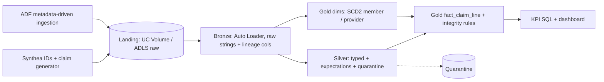

# Claims Payment Integrity Lakehouse

A healthcare claims data platform on Azure/Databricks that ingests claim, member, provider and
eligibility data, lands it in a Bronze/Silver/Gold lakehouse, and flags improper payments
(duplicates, overbilling, diagnosis/procedure mismatches, billing outside coverage, invalid
amounts) before they reach analysts.

> **Synthetic data only.** Members and providers come from [Synthea](https://github.com/synthetichealth/synthea)
> (or are randomly generated). Claim lines are generated with *labelled* injected anomalies so the rules can be
> scored. Procedure codes are invented demo codes and the procedure-to-diagnosis pairings carry no clinical meaning.
> No real patient data, and no claim of HIPAA compliance.

## What is verified and what is not

| Component | Status |
|---|---|
| Rule library (`src/claims_integrity/rules.py`) | Unit-tested with PySpark locally (`pytest`, 9 tests) |
| Data generator (`scripts/generate_claim_lines.py`) | Unit-tested; deterministic with a seed |
| Local end-to-end demo (`scripts/run_local_demo.py`) | Run locally; scores rules against injected ground truth |
| Databricks notebooks, DLT pipeline, SCD2 MERGE, bundle | Written to documented APIs, **not yet run on a workspace**. Run them, fix what breaks, then update this table |
| ADF framework + Azure SQL control scripts | Design + T-SQL, **not yet run in Azure** |
| Unity Catalog masks/grants | Pattern only; Free Edition may not support all of it |

## Architecture



Details: [docs/architecture.md](docs/architecture.md), [docs/data_model.md](docs/data_model.md),
[docs/rules_catalog.md](docs/rules_catalog.md).

## Quick start (local, no cloud)

Requires Python 3.11+, Java 17+.

```bash
pip install -r requirements-dev.txt
pytest -q                                              # unit tests
python scripts/generate_claim_lines.py --out data/generated
python scripts/run_local_demo.py --data data/generated # rule hits + precision/recall
```

Optional: generate members/providers with Synthea first and pass `--patients patients.csv --providers providers.csv`.

## Run on Databricks Free Edition + Azure

Step by step in [docs/setup_free_tier.md](docs/setup_free_tier.md) and [docs/runbook.md](docs/runbook.md).

## Results (fill in from your own runs)

| Metric | Value |
|---|---|
| Lines processed | _fill in_ |
| Flagged lines / paid amount flagged | _fill in_ |
| Rule precision / recall on injected anomalies (local) | _fill in; expect ~1.0 because the generator and rules share definitions. This is a sanity check, not real-world accuracy_ |
| Query time before/after OPTIMIZE / clustering on `fact_claim_line` | _fill in with your measurements_ |
| Pipeline run time (full / incremental) | _fill in_ |

## Repo layout

```
src/claims_integrity/   rules, evaluation helpers, config
scripts/                data generator, local demo
notebooks/              00 setup, 01 bronze, 02 silver pipeline, 03 SCD2 dims, 04 rules + gold
sql/                    KPI queries (CTEs, window functions), Unity Catalog governance
adf/                    control-table T-SQL, sample config, ADF design notes
tests/                  PySpark unit tests, generator tests
.github/workflows/      CI (lint + tests)
databricks.yml          Asset Bundle (pipeline + workflow), unvalidated
docs/                   architecture, data model, rules, runbook, setup, interview notes
```

## Known limitations

- Rules are simplified teaching versions of payment-integrity logic, not production edits.
- The overbilling reference is derived from the data itself (median allowed per unit); a real system would use a fee schedule.
- Eligibility is one span per member; real eligibility has gaps, terminations and COB.
- Scores of 1.0 on the generated data only show the rules find what the generator injects.
